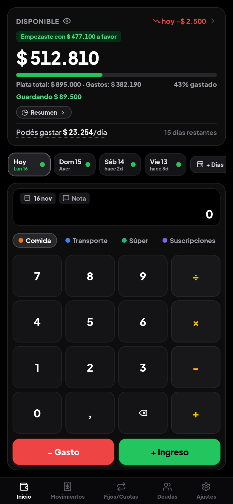
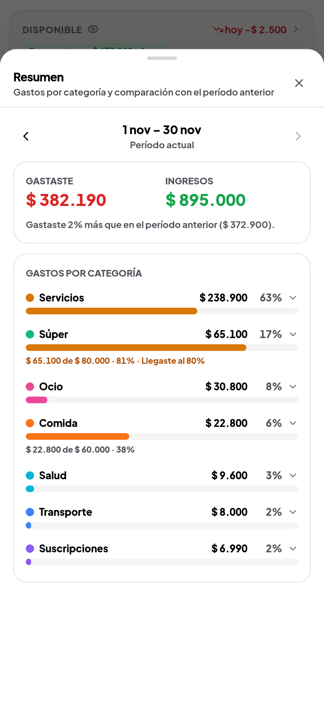
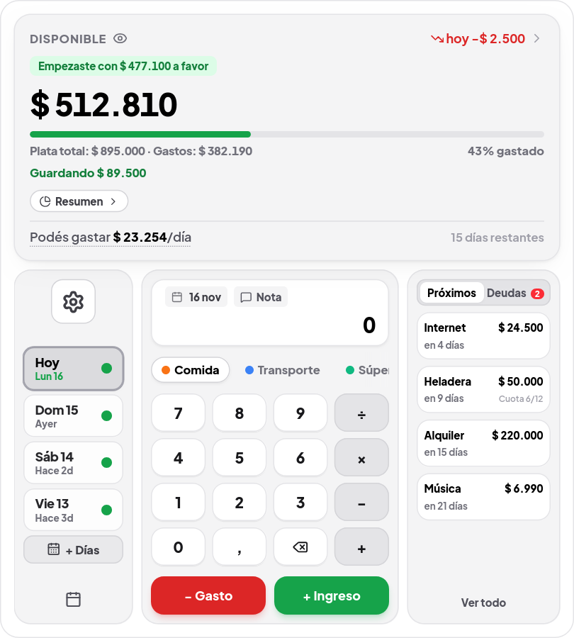

# Bolsillo

**Una app chiquita para saber, cada día, cuánta plata te queda.**

Anotás gastos e ingresos con una calculadora y Bolsillo te dice cuánto tenés disponible y cuánto podés gastar por día hasta el próximo cobro. Todo se guarda en tu dispositivo: sin cuentas, sin nube, sin publicidad y sin rastreo.

Pensada para Argentina: pesos sin centavos (`$ 20.000`), interfaz en español rioplatense y, si querés, ahorros y deudas en dólares.

👉 **Probala en el navegador:** https://bolsillo.santiagopicusen.workers.dev

<p align="center">
  
  &nbsp;
  
</p>
<p align="center">
  
</p>

<sub>Las capturas usan datos de ejemplo inventados.</sub>

## Qué hace

- **Disponible en grande**: lo que cobraste en el período menos lo que gastaste, y **"Podés gastar $ X por día"**, que ya descuenta los fijos y cuotas que están por venir.
- **Calculadora rápida**: `3500 × 4` y Enter. Elegís la categoría con un toque.
- **Sueldo fijo** (monto y día de cobro) o **sueldo por día** (tarifa diaria, días libres y cambios de tarifa).
- **Fijos y cuotas** que se anotan solos el día que vencen, con aviso antes del vencimiento.
- **Deudas**: lo que debés y lo que te deben, agrupado por persona, con pagos parciales.
- **Resumen** del período: gastos por categoría, topes por categoría y comparación con el período anterior.
- **Dólares** (opcional): ahorros en dólares separados del día a día, compra y venta, y la cotización del día.
- **Buscador** en todo el historial por nota, categoría o monto.
- **Recordatorio diario** si no anotaste nada.
- **Privacidad**: botón para ocultar los montos, bloqueo con PIN o contraseña con **los datos cifrados** (AES-256).
- **Backup** en un archivo JSON (cifrado si usás contraseña) para pasar tus datos de un dispositivo a otro.
- Temas **Blanco** y **Negro**. Funciona sin conexión.

> La única conexión a internet que hace la app es pedir la cotización del dólar a [dolarapi.com](https://dolarapi.com), y solo cuando tocás "Cotización del día". No se manda ningún dato tuyo.

## Instalarla en el celular

Bolsillo es una **PWA**: una página web que se instala como una app y funciona sin internet.

**iPhone (Safari)**
1. Abrí https://bolsillo.santiagopicusen.workers.dev en **Safari**.
2. Tocá el botón **Compartir** (el cuadrado con la flecha hacia arriba).
3. Elegí **Agregar a inicio**.

**Android (Chrome)**
1. Abrí https://bolsillo.santiagopicusen.workers.dev en **Chrome**.
2. Tocá el menú **⋮** y elegí **Instalar app** (o **Agregar a la pantalla principal**).

Tus datos quedan solo en ese teléfono. Para pasarlos de un dispositivo a otro: Ajustes → Backup → **Exportar** en uno e **Importar** en el otro.

> En iPhone, Safari no permite avisos programados sin un servidor, así que el recordatorio aparece como cartel "Te falta anotar" cuando abrís la app.

## Compilarla en Linux (app de escritorio)

La versión de escritorio usa [Tauri 2](https://tauri.app). Necesitás Node.js, pnpm y Rust.

**1. Dependencias del sistema** (Arch Linux y derivadas; para otras distribuciones mirá la [guía de Tauri](https://tauri.app/start/prerequisites/)):

```bash
sudo pacman -S --needed webkit2gtk-4.1 base-devel curl wget file openssl librsvg nodejs pnpm rustup
rustup default stable
```

**2. Bajar el código y compilar:**

```bash
git clone <URL-de-este-repositorio> bolsillo
cd bolsillo
pnpm install       # baja las dependencias
pnpm tauri build   # compila; tarda unos minutos la primera vez
```

El programa queda en `src-tauri/target/release/bolsillo` (también se arman paquetes `.deb` y `.rpm` en `src-tauri/target/release/bundle/`).

**3. Instalarlo para tu usuario** (con su ícono en el menú de aplicaciones):

```bash
install -Dm755 src-tauri/target/release/bolsillo ~/.local/bin/bolsillo
install -Dm644 public/icons/icon-512.png ~/.local/share/icons/hicolor/512x512/apps/bolsillo.png
install -Dm644 bolsillo.desktop ~/.local/share/applications/bolsillo.desktop
```

Tus datos se guardan en `~/.local/share/com.bolsillo.desktop/`. Copiá esa carpeta antes de instalar una versión nueva.

### Para programar

```bash
pnpm tauri dev   # abre la app y se recarga sola al editar
pnpm dev         # solo la versión web, en el navegador
pnpm test        # corre los tests
pnpm build       # arma la versión web (PWA) en dist/
```

Hecha con Tauri 2, React 19, TypeScript, Tailwind CSS 4, Motion y Dexie (IndexedDB).

## Atajos de teclado (escritorio)

| Tecla | Acción |
| :--- | :--- |
| `0`–`9`, `,` | Escribir el monto |
| `+` `-` `*` `/` | Operaciones |
| `Backspace` | Borrar el último dígito |
| `Escape` | Limpiar (o cerrar el panel abierto) |
| `Enter` | Guardar como **gasto** |
| `Shift + Enter` | Guardar como **ingreso** |

## Licencia

Bolsillo es **software libre** bajo la licencia [GNU GPL-3.0](LICENSE): podés usarlo, estudiarlo, compartirlo y modificarlo, siempre que lo que distribuyas también se comparta con la misma licencia y su código fuente.

Copyright © 2026 PiKuSen27.

## Créditos

Hecho por **PiKuSen27** con [Claude](https://claude.ai).
